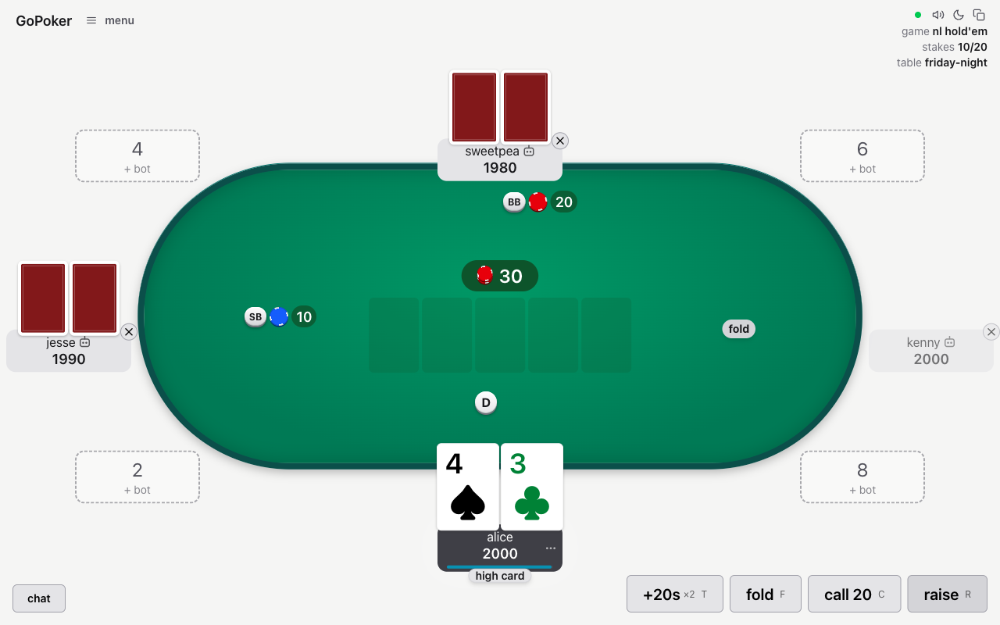
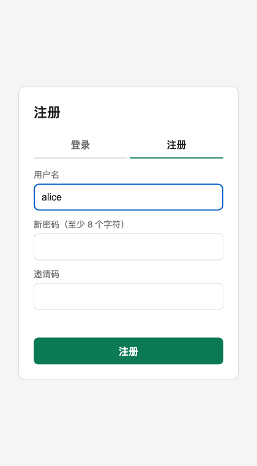
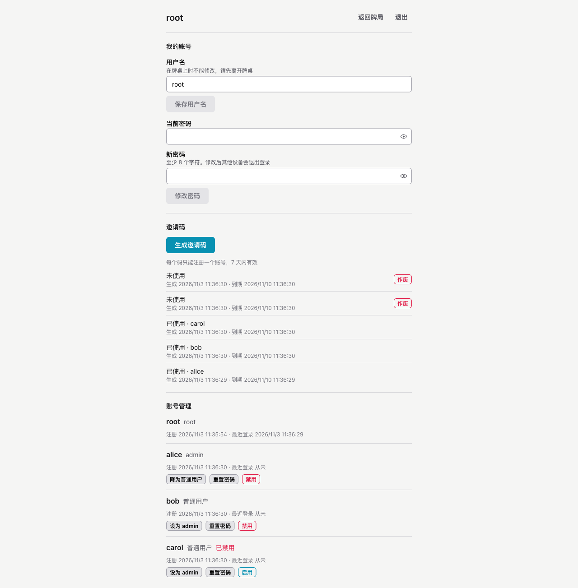

<div align="center">

# go-poker · private tables

**Self-hosted, invite-only poker for you and your friends.**
Real-time multiplayer Texas Hold'em and Omaha in the browser, behind accounts that only you can hand out.

[](LICENSE)
[](backend/go.mod)
[](web/)
[](https://github.com/evanofslack/go-poker)

**English** · [简体中文](README.zh-CN.md)



</div>

## Why this fork

[evanofslack/go-poker](https://github.com/evanofslack/go-poker) is an excellent poker app: no
downloads, works on phones, tracks every buy-in, and has bots and house rules. But it is open to
anyone who finds the URL.

This fork turns it into a **private site**. Nobody can load the game or open a websocket without an
account, and the only way to get an account is a one-time invite code from you.

## Features

**Access control (this fork)**

- 🔐 **Accounts are required.** Signed-out visitors are redirected to the login page, never get the
  game's JavaScript, and get `401` on the websocket.
- 🎟️ **One invite code per person.** Codes are single use, expire after 7 days, are stored only as
  hashes, and can be revoked.
- 👑 **Three roles.** `root` manages accounts and invites, `admin` can create tables, `user` can only
  join a table by its name. Every check is on the server.
- 🪪 **Stable identity.** Accounts are keyed by UUID, so people can rename themselves. Usernames are
  unique (case-insensitive) and can't change while you're at an open table (seated or watching).
- 🚪 **Kick out instantly.** Disabling an account ends its sessions and drops its connections
  right away.
- 🧭 **Lives under `/poker`.** Your reverse proxy forwards one path and can return 404 for
  everything else.

**The game (from upstream)**

- 🃏 No limit and pot limit Hold'em, Omaha and 5 card Omaha; full or short deck
- 🤖 Bots at three levels to fill empty seats
- 💰 Ledger of every buy-in and cash out, with who pays whom at the end
- 📊 Per-player stats and full hand history
- 🎲 House rules: 7-2 bounty, straddles, run it twice, bomb pots, time cards
- 📱 Phone layout, reconnect with your seat kept, games survive server restarts

<table>
  <tr>
    <td align="center" width="34%"><br><sub>Register with an invite code</sub></td>
    <td align="center"><br><sub>root manages invites and accounts</sub></td>
  </tr>
</table>

## Quick start

You need Docker with Compose.

```bash
git clone https://github.com/muxia23/go-poker.git
cd go-poker
# edit ROOT_PASSWORD in docker-compose.yaml first
docker compose up -d --build
```

Open <http://localhost:8080/poker> and sign in as `root` with the password from
`docker-compose.yaml`. You'll be asked to choose a new one right away.

> [!IMPORTANT]
> The session cookie is `Secure`, so outside `localhost` the site has to be served over **HTTPS**.
> See [Deploying behind a reverse proxy](#deploying-behind-a-reverse-proxy).

## How it works

```text
root ──creates invite code──▶ friend registers (username + password + code)
root ──promotes to admin────▶ admin creates a table "friday-night"
everyone else ──types "friday-night"──▶ joins
```

| | root | admin | user |
|---|:---:|:---:|:---:|
| Join a table by name | ✅ | ✅ | ✅ |
| Create a table | ✅ | ✅ | ❌ |
| Change own username and password | ✅ | ✅ | ✅ |
| Generate and revoke invite codes | ✅ | ❌ | ❌ |
| Promote, disable or reset other accounts | ✅ | ❌ | ❌ |

- There is exactly one `root`. It can't be disabled or demoted.
- Host powers inside a table (kick, adjust stacks, …) belong to whoever hosts that table, not to the
  site role.
- Public tables are turned off: you have to know a table's name to join it.

## Deploying behind a reverse proxy

Publish the container on loopback only, and let your proxy terminate TLS and forward `/poker`:

```yaml
# docker-compose.yaml
    ports:
      - 127.0.0.1:8080:8080
    environment:
      TRUST_PROXY: "true"   # read the client IP from X-Forwarded-For
```

```nginx
location /poker {
    proxy_pass http://127.0.0.1:8080;
    proxy_http_version 1.1;
    proxy_set_header Upgrade $http_upgrade;
    proxy_set_header Connection "upgrade";
    proxy_set_header Host $host;
    proxy_set_header X-Forwarded-For $remote_addr;
    proxy_set_header X-Forwarded-Proto https;
    proxy_read_timeout 3600;
}

location / {
    return 404;
}
```

> [!NOTE]
> `/poker` only hides the site from casual scans. The actual protection is the login and the
> server-side role checks.

## Configuration

Environment variables added by this fork:

| Variable | Default | |
|---|---|---|
| `DATABASE_URL` | **required** | `sqlite:/data/poker.db` or `postgres://…`. Accounts must be stored, so there is no in-memory mode. |
| `ROOT_USERNAME` | | Creates the root account on first start, when there is none. Ignored afterwards. |
| `ROOT_PASSWORD` | | Its initial password, at least 8 characters. It must be changed at first login. |
| `LOGIN_ATTEMPTS` | `5` | Failed logins or registrations allowed per IP and per username in 15 minutes. |

Every upstream option (limits, timeouts, `ADMIN_ADDR`, `METRICS_ADDR`, …) still works. See
[`.env.example`](.env.example) and [`backend/server/config.go`](backend/server/config.go).

**Forgot the root password?**

```bash
docker exec go-poker ./main reset-root
```

This prints a temporary password, which has to be changed at the next login.

## Development

Needs Go, Node and [just](https://github.com/casey/just).

```bash
just serve   # builds the web app and serves everything on http://localhost:8080/poker
just check   # the same checks as CI
just e2e     # browser tests, see e2e/README.md
```

`just serve` keeps its data in `backend/dev.db`. The first root login is `root` / `change-me-now`.

> [!NOTE]
> `just start` (hot reload on :3000) doesn't work in this fork yet: the login API is served by the Go
> server, and the Next dev server on another port doesn't forward it.

The design and the implementation plan for the account system are in
[`docs/superpowers/`](docs/superpowers/). Account code lives in [`backend/auth/`](backend/auth/).

## Status

- Running for a private group. Backend tests and the browser end-to-end suite pass.
- Accounts have been tested on **SQLite** only. The Postgres store shares the same SQL, but this
  fork hasn't run it against Postgres.
- The login, register and accounts pages are in Chinese. The game itself is in English.

## Credits

All of the game is the work of [Evan Slack](https://github.com/evanofslack) and the contributors to
[evanofslack/go-poker](https://github.com/evanofslack/go-poker). This fork only adds the accounts
layer on top.

## License

[MIT](LICENSE), same as upstream.
