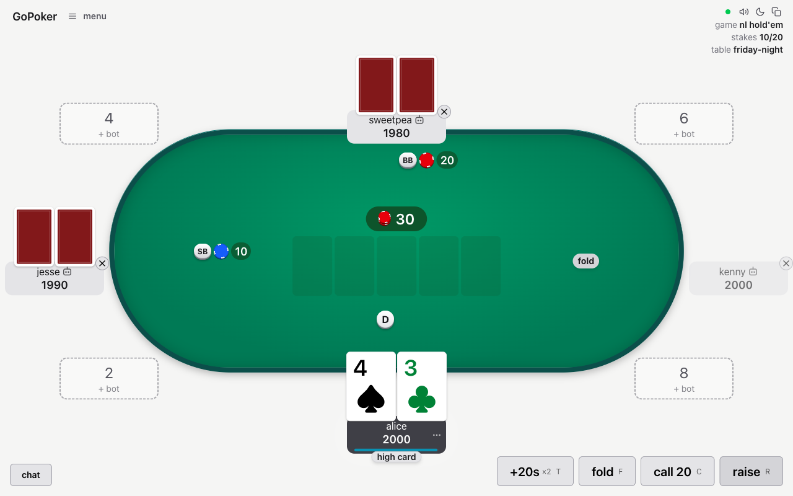
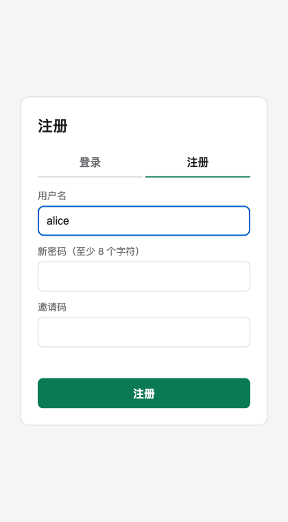
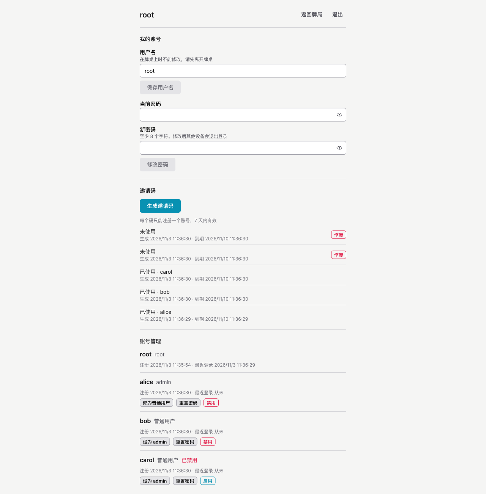

<div align="center">

# go-poker · 私人牌局

**自己部署、只能凭邀请码加入的朋友牌局。**
浏览器里就能实时多人打德州扑克和奥马哈，账号只能由你发放。

[](LICENSE)
[](backend/go.mod)
[](web/)
[](https://github.com/evanofslack/go-poker)

[English](README.md) · **简体中文**



</div>

## 为什么有这个 fork

[evanofslack/go-poker](https://github.com/evanofslack/go-poker) 是一个很好用的扑克应用：不用下载，
手机上能玩，每笔买入都有记账，还有机器人和各种房规。但它对所有人开放，谁拿到网址都能进。

这个 fork 把它改成了**私人站点**。没有账号就加载不了游戏，也连不上 WebSocket；而拿到账号的唯一途径，
是你发出的一次性邀请码。

## 功能

**访问控制（本 fork 新增）**

- 🔐 **必须登录。** 未登录的访客会被跳转到登录页，拿不到游戏代码，连 WebSocket 会收到 `401`。
- 🎟️ **一人一码。** 邀请码只能用一次，7 天后过期，数据库只存哈希值，可以随时作废。
- 👑 **三级权限。** `root` 管理账号和邀请码，`admin` 可以开桌，`user` 只能输入房间号加入。
  所有权限都在服务端校验。
- 🪪 **身份不变。** 账号以 UUID 为准，所以可以改名。用户名全站唯一（不区分大小写），
  在任何一张未关闭的牌桌上（入座或旁观）时不能改。
- 🚪 **立刻踢出。** 禁用账号后，它的登录会话全部失效，在线连接马上断开。
- 🧭 **只占 `/poker` 路径。** 反向代理只转发这一个路径，其余可以一律返回 404。

**游戏本身（来自上游）**

- 🃏 无限注和底池限注的德州扑克、奥马哈、五张奥马哈；完整牌组或短牌
- 🤖 三种难度的机器人，用来补空位
- 💰 记录每笔买入和兑出，结束时算好谁该给谁多少
- 📊 每个人的统计数据和完整手牌历史
- 🎲 房规：7-2 奖励、Straddle、发两次牌（run it twice）、Bomb pot、时间卡
- 📱 适配手机，断线重连保留座位，服务器重启后牌局继续

<table>
  <tr>
    <td align="center" width="34%"><br><sub>用邀请码注册</sub></td>
    <td align="center"><br><sub>root 管理邀请码和账号</sub></td>
  </tr>
</table>

## 快速开始

需要安装 Docker 和 Compose。

```bash
git clone https://github.com/muxia23/go-poker.git
cd go-poker
# 先修改 docker-compose.yaml 里的 ROOT_PASSWORD
docker compose up -d --build
```

打开 <http://localhost:8080/poker>，用 `root` 和 `docker-compose.yaml` 里设置的密码登录。
系统会要求你马上改一个新密码。

> [!IMPORTANT]
> 登录 Cookie 带 `Secure` 属性，所以除了 `localhost`，站点必须通过 **HTTPS** 访问。
> 见[部署到反向代理后面](#部署到反向代理后面)。

## 使用流程

```text
root ──生成邀请码──▶ 朋友注册（用户名 + 密码 + 邀请码）
root ──提升为 admin──▶ admin 开一桌 "friday-night"
其他人 ──输入 "friday-night"──▶ 加入
```

| | root | admin | user |
|---|:---:|:---:|:---:|
| 输入房间号加入牌桌 | ✅ | ✅ | ✅ |
| 开桌 | ✅ | ✅ | ❌ |
| 修改自己的用户名和密码 | ✅ | ✅ | ✅ |
| 生成、作废邀请码 | ✅ | ❌ | ❌ |
| 提升、禁用其他账号，重置其密码 | ✅ | ❌ | ❌ |

- 系统只有一个 `root`，不能被禁用或降级。
- 牌桌内的房主权限（踢人、调整筹码等）属于这张桌子的房主，和站点角色无关。
- 公开牌桌列表已关闭，必须知道房间号才能加入。

## 部署到反向代理后面

容器端口只绑定到本机回环地址，由反向代理负责 TLS，并只转发 `/poker`：

```yaml
# docker-compose.yaml
    ports:
      - 127.0.0.1:8080:8080
    environment:
      TRUST_PROXY: "true"   # 从 X-Forwarded-For 读取客户端 IP
```

```nginx
location /poker {
    proxy_pass http://127.0.0.1:8080;
    proxy_http_version 1.1;
    proxy_set_header Upgrade $http_upgrade;
    proxy_set_header Connection "upgrade";
    proxy_set_header Host $host;
    proxy_set_header X-Forwarded-For $remote_addr;
    proxy_set_header X-Forwarded-Proto https;
    proxy_read_timeout 3600;
}

location / {
    return 404;
}
```

> [!NOTE]
> `/poker` 路径只能挡住随手的扫描，真正起保护作用的是登录和服务端的权限校验。

## 配置

本 fork 新增的环境变量：

| 变量 | 默认值 | 说明 |
|---|---|---|
| `DATABASE_URL` | **必填** | `sqlite:/data/poker.db` 或 `postgres://…`。账号必须持久保存，所以没有纯内存模式。 |
| `ROOT_USERNAME` | | 首次启动且还没有 root 时，用它创建 root 账号，之后不再生效。 |
| `ROOT_PASSWORD` | | root 的初始密码，至少 8 个字符，首次登录必须修改。 |
| `LOGIN_ATTEMPTS` | `5` | 15 分钟内，每个 IP、每个用户名允许失败的登录或注册次数。 |

上游原有的配置项（各种限制、超时、`ADMIN_ADDR`、`METRICS_ADDR` 等）都继续有效，
见 [`.env.example`](.env.example) 和 [`backend/server/config.go`](backend/server/config.go)。

**忘记 root 密码？**

```bash
docker exec go-poker ./main reset-root
```

它会输出一个临时密码，下次登录时必须修改。

## 开发

需要 Go、Node 和 [just](https://github.com/casey/just)。

```bash
just serve   # 构建前端，在 http://localhost:8080/poker 提供完整站点
just check   # 和 CI 相同的检查
just e2e     # 浏览器端到端测试，见 e2e/README.md
```

`just serve` 的数据保存在 `backend/dev.db`，root 首次登录用 `root` / `change-me-now`。

> [!NOTE]
> `just start`（:3000 端口热更新）在本 fork 里暂时不可用：登录接口由 Go 服务提供，
> 而另一个端口上的 Next 开发服务器不会转发它。

账号系统的设计文档和实施计划在 [`docs/superpowers/`](docs/superpowers/)，
账号代码在 [`backend/auth/`](backend/auth/)。

## 状态

- 正在给一个朋友小圈子使用。后端测试和浏览器端到端测试全部通过。
- 账号功能只在 **SQLite** 上测试过。Postgres 存储用的是同一套 SQL，但本 fork 没有在 Postgres 上跑过。
- 登录、注册和账号页是中文，牌局界面是英文。

## 致谢

游戏部分全部出自 [Evan Slack](https://github.com/evanofslack) 和
[evanofslack/go-poker](https://github.com/evanofslack/go-poker) 的贡献者。本 fork 只是在上面加了一层账号系统。

## 许可证

[MIT](LICENSE)，与上游相同。
